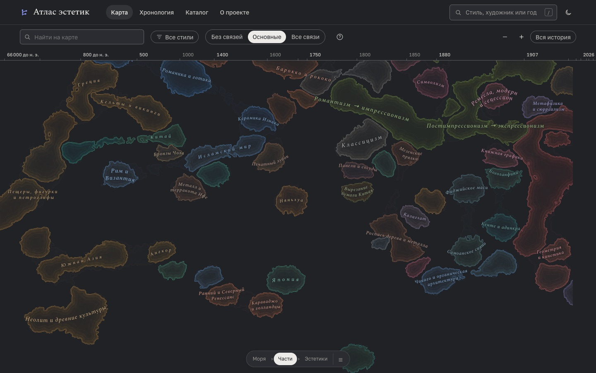
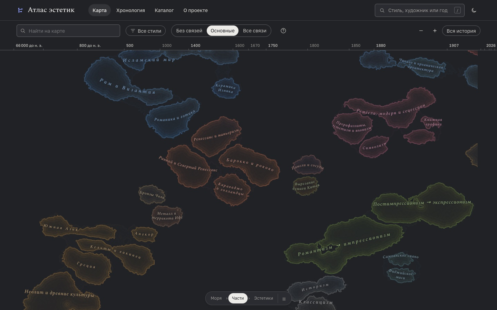
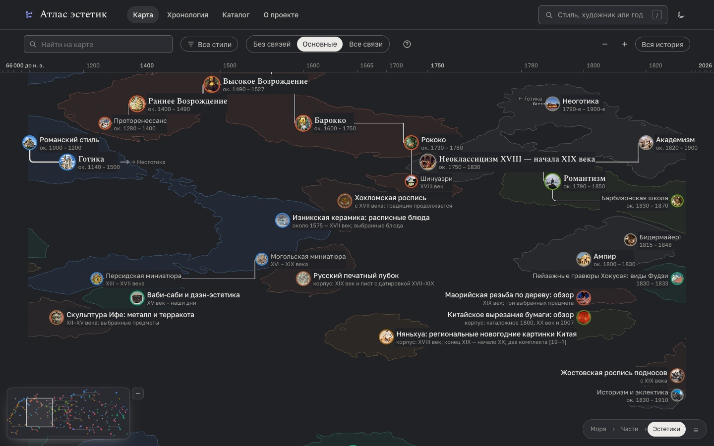
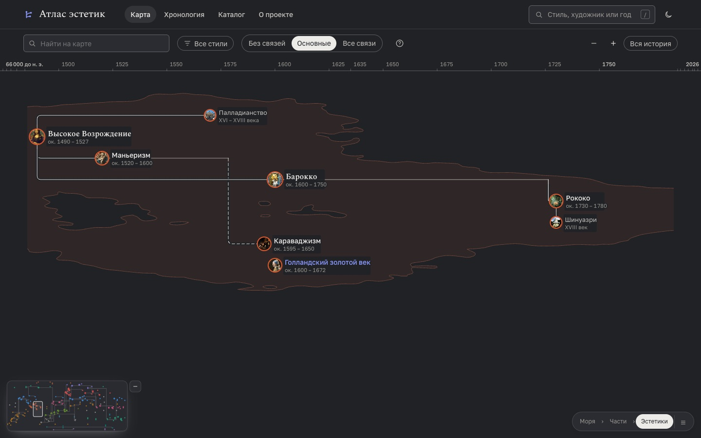
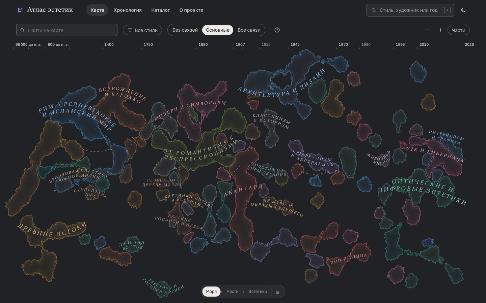
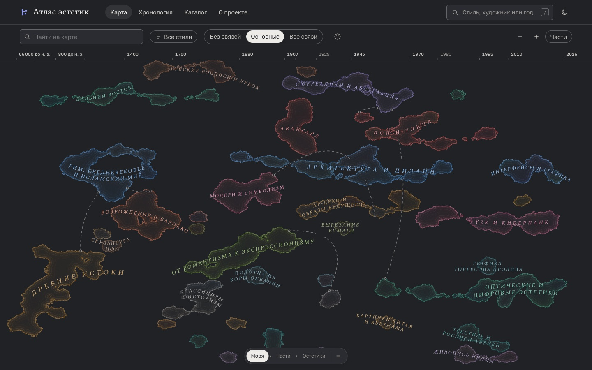

# Карта: моря и части блоками

26 октября 2026 года. Повод — комментарий на Хабре: «Возрождение» касается чужого стиля на маленьком островке в углу, а при приближении этот слой пропадает.

## Что происходило

Строку карточке выбирала раскладка генеалогии (`layoutGenealogy` в `js/layout.js`): потомок ставится у строки главного предка (`parents[0]`), моря при этом не учитываются. Море и часть рисуются облаком плотности вокруг своих карточек (`js/nebulae.js`), поэтому море рвётся на острова, если его карточки разошлись по строкам.

У «Северного Возрождения» первый предок — «Интернациональная готика» из моря «Рим, Средневековье и исламский мир». Раскладка поставила его на 26-ю строку, рядом с готикой, а не на 3–11-ю, где лежит остальное «Возрождение и барокко». «Голландский золотой век» пошёл за ним на 27-ю. Получились два острова: «Ранний и Северный Ренессанс» и «Караваджо и голландцы» — внизу, вплотную к «Японии» и «Романике и готике». Рамки этих частей на живом сайте — 750 и 916 px по высоте при двух-трёх карточках в каждой. У всего моря тоже 916 px.

«Пропадает при приближении» складывается из двух причин:
- **Задуманный переход семантического масштаба** (`js/map-detail.js`). Между уровнем частей и уровнем эстетик (ratio 0,96–1,28) отмывка и названия частей гаснут у всех частей сразу. Остаются тонкий берег моря и заливка непрозрачностью 4,5% в светлой теме и 7,5% в тёмной. У маленького оторванного островка этого почти не видно.
- **Приближение к разорванной части.** Нажатие на часть (`focusRegion` в `js/views/map.js`) вписывает в экран рамку всех её карточек с масштабом уровня эстетик. У «Караваджо и голландцев» одна карточка на 3-й строке, другая на 27-й, и центр рамки приходится на пустое место между ними. На кадре после нажатия нет ни «Караваджизма», ни «Голландского золотого века», ни «Северного Возрождения».

Кадры ниже сняты одним и тем же сценарием в изолированном безголовом Chrome при 1440 × 900: общий вид → кнопка «Части» со сдвигом карты к «Возрождению» → нажатие на «Караваджо и голландцы». «До» — опубликованный сайт (`main.js?v=ai-4`), «после» — исправленная версия на локальном сервере.

## Что сделано

- `layoutRegions` в `js/layout.js`. Море — блок строк × время, внутри него так же блоками лежат части, внутри части — прежнее древо. У блока нет вертикальных дыр, поэтому чужая карточка не встанет между строками моря в то же время. Блоки разных морей не пересекаются. Там, где моря идут в одно время, между ними пустая строка, а в соседних строках — 120 px по времени (`SEA_GAP` в `js/map-layout.js`).
- Карточка тянется к предку из своего блока. Связи между блоками решают, где блок встанет. Жадная укладка пробует три порядка и берёт самую низкую карту.
- `lay.primary` прежний: ветви, их вес и ориентиры по-прежнему считаются от `parents[0]`.
- `js/map-layout.js` — общая сборка узлов: шкала, ширины подписей и константы. Её вызывают и `map.js`, и тест, поэтому тест проверяет ту же раскладку, что рисует сайт.
- `test/map-layout.test.mjs` проверяет на настоящих данных:
  - каждая карточка части не дальше 8 строк от центра своего моря (медианной строки);
  - области разных морей с этим зазором не пересекаются.

  Отдельный тест подтверждает, что та же проверка ловит разрыв «Караваджо и голландцы» в прежней раскладке. Ещё один проверяет скорость на 650 карточках.
- `scripts/dev/map-islands.js` — консольная проверка по настоящим маскам областей. Она:
  - считает острова каждого моря и каждой части;
  - проверяет, все ли карточки лежат в одном острове;
  - ищет карточки, окружённые чужим морем;
  - ищет пары разных морей, подошедших ближе 6 px поля.

## Замеры

Окно 1440 × 900, те же данные, маски областей из `nebulae.js`:

| | Было | Стало |
| --- | --- | --- |
| Строк раскладки | 32 | 53 |
| Островов у морей / у частей | 104 / 133 | 60 / 100 |
| Морей, распавшихся на куски | 22 из 25 | 14 |
| Частей, распавшихся на куски | 41 | 19 |
| Пар разных морей ближе 6 px поля | 23 | 0 |
| Карточек, окружённых чужим морем | 12 | 0 |
| Наибольшее удаление карточки от центра моря | 22 строки | 7 строк (4 — у всех, кроме «Древних истоков») |
| Средняя высота ветви древа | 1,4 строки | 5,6 строки |

Оставшиеся разрывы — паузы во времени внутри одного моря на тех же строках. Например, «Дальний Восток»: древний Китай, шань-шуй, ямато-э, укиё-э и Сюй Бин. По горизонтали двигать нельзя — это время, а протоки между далёкими по времени карточками облако не строит.

## Цена

- Карта выше: 53 строки вместо 32. На общем виде всё вписывается по высоте, моря становятся площе.
- Названия морей на общем виде: 9 при 390 px, 19 при 768, 23 при 1440 и 23 при 1920 px. В отчёте 15 октября было 11, 17, 20 и 23. «Возрождение и барокко» подписано на всех четырёх ширинах. Список морей, нажатие на область и приближение работают как раньше.
- Ветви между морями длиннее: связь из одного моря в другое теперь проходит через зазор между блоками.

## Проверка

- `npm test`: все тесты, включая новые для раскладки и для повторяющихся миниатюр.
- `scripts/dev/map-geometry.js`:
  - общий вид при 390, 768, 1440 и 1920 px;
  - уровни частей и эстетик при 1440 px.

  Наложений названий и подписей нет, видимых линий сквозь текст нет. Ошибок в консоли нет.
- «До» воспроизведено на опубликованном сайте в изолированном безголовом Chrome: все три уровня, рамки частей и нажатие на часть. Замеры островов и касаний для «до» сделаны на локальном сервере с прежней раскладкой: его файлы побайтно совпадают с опубликованными (`data/atlas.json`, `js/layout.js`, `js/nebulae.js`, `js/views/map.js`, `index.html`).
