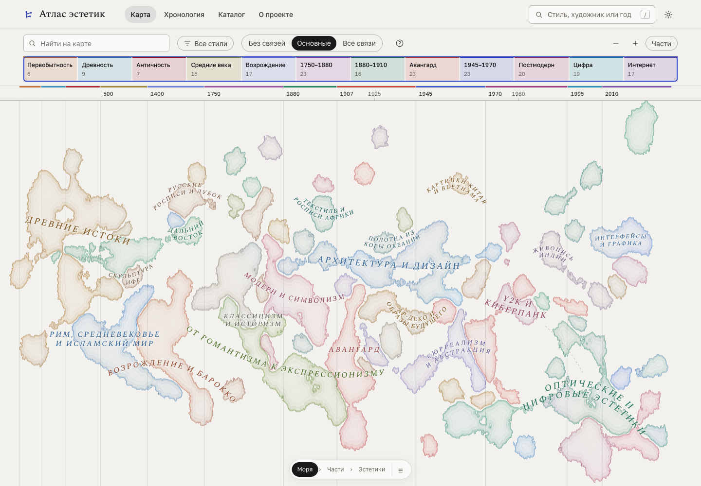
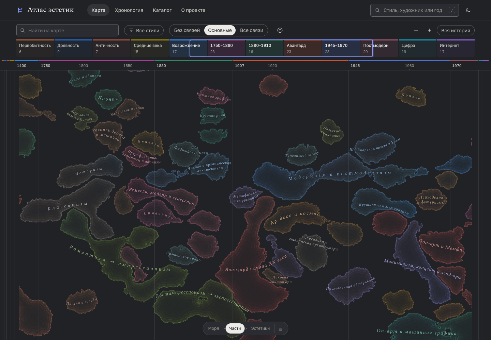
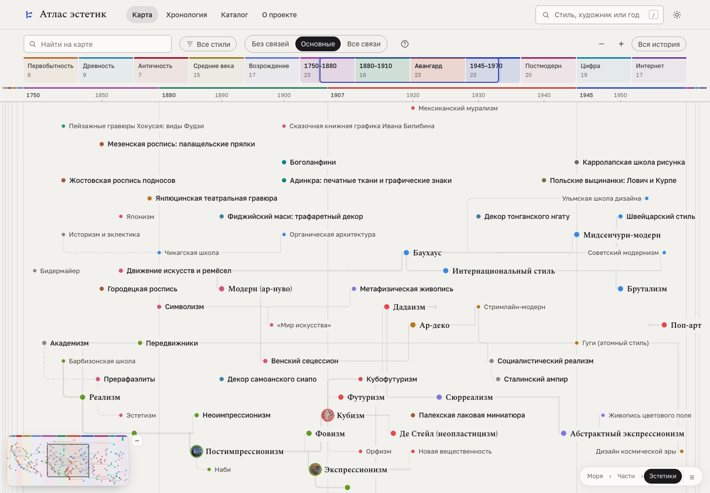
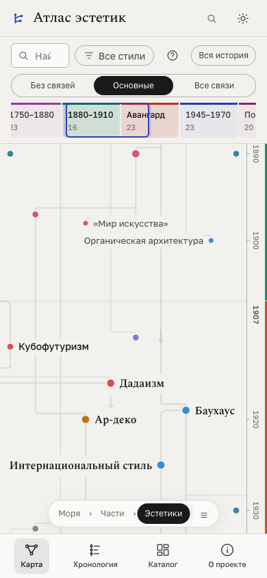

# Карта: согласованные уровни масштаба

Подготовленный вариант 15 октября 2026 года, поверх партии каталога 03 (`247abd4`, PR №9). Слияние и публикация не выполнялись. Корпус из 195 карточек, 25 морей и 74 частей, даты, отношения, историческая раскладка и состав областей не изменены.

## Проблема и решение

Раньше исчезали только названия эстетик: точки, стволы, ветви и миниатюры продолжали конкурировать с морями. На среднем масштабе одновременно читались три системы текста. На близком масштабе горизонтальная ось растягивала контуры в длинные полосы, не добавляя информации.

Теперь все слои следуют одному ходу масштаба. Их приоритет меняется последовательно:

| Уровень | Главный предмет чтения | Что остаётся | Что уходит |
| --- | --- | --- | --- |
| Вся история — начальный вид | Моря | Силуэты, крупные названия, несколько сводных линий | Отдельные точки, миниатюры, подписи, ветви, стволы, миникарта |
| Части | Внутренние области | Названия частей, облегчённая гравировка | Крупные названия морей и сводные линии; карточки ещё не конкурируют с частями |
| Эстетики | Названия и точки карточек | Краткие подписи, затем даты и миниатюры; появляется миникарта | Названия областей, затем полностью их заливка и береговые линии |
| Связи и фокус | Конкретная карточка и её отношения | Основные или все видимые связи, объяснения по нажатию, ближайшие связи и маршрут | Фоновая география и точки в сжатых боковых желобах |

Контуры полностью исчезают до сильного растяжения. Их геометрия не «плавает» независимо от узлов: принадлежность к морям и частям сохраняется. У выбранного стиля и его связей остаётся приоритет при отдалении; режим «Без связей» не включает линии обратно из-за выбора. Верхний предел приближения сокращён с 5 до 2: за ним увеличивались только пустые промежутки между датами.

### Общий вид

### Чтение частей

### Карточки

## Навигация и сводные связи

Нижняя панель «Моря → Части → Эстетики» показывает текущий уровень и позволяет перейти к нему без точного попадания в масштаб. Клик по области или её названию приближает область; по части — карточки. Доступны клавиатурное управление и список всех морей, включая 11 карточек вне них. Невидимые точки не получают фокус и не перехватывают нажатия.

Дальний план показывает до шести наиболее наполненных сводок в режиме «Основные» или до десяти в режиме «Все связи». При наведении на море остаются относящиеся к нему сводки. Каждая линия объединяет **реальные отношения карточек**, а не объявляет влияние одного моря на другое. Нажатие открывает полный список объединённых отношений; далее доступно прежнее объяснение конкретной связи и её источники. Направления, типы и статусы сохраняются. Внутренние отношения одного моря и карточки без моря не создают ложных межморских линий.

Сводки и выделенные конкретные связи проходят под масками названий областей, включая случай отдаления с выбранной карточкой. Попадание по названию имеет приоритет над линией под ним. «Без связей» отключает и сводки, и ветви, и маршрут; фильтр подтверждения действует также на сводки. При включённой проверке одиночные подтверждённые отношения не отбрасываются из-за малого числа связей в группе. Сопоставления не превращаются в подтверждённое историческое влияние.

Вблизи боковые желоба сохраняют камеру и шкалу, но больше не рисуют плотные колонны неподписанных точек. Фоновые ветви между сжатыми концами скрыты; отношения выбранной карточки доступны через фокус, панель и переходы.

## Узкие экраны

Время по-прежнему идёт сверху вниз, но названия морей, частей, эстетик и даты читаются **горизонтально**. Для текста и подложек используется обратное преобразование; проверка наложений остаётся в общей системе координат. Полное длинное имя доступно в карточке, подпись на карте сокращается по измеренной свободной ширине.

На полном обзоре не все 25 названий одновременно помещаются: 11 при 390 px, 17 при 768, 20 при 1440 и 23 при 1920 в проверенных кадрах. Непоместившиеся подписи не накладываются на соседей. Все 25 морей доступны через список и нажатие на саму область; масштаб и поиск сохраняют доступ ко всем карточкам.

## Реализация и проверка

`js/map-detail.js` задаёт совместные прозрачности слоёв и собирает сводки исходных отношений. Масштаб перехода учитывает размер окна и вписанную полную историю. Два кэша canvas хранят море и части отдельно: смешивание и затухание происходят на каждом кадре, без ожидания перерисовки битмапа. Контуры облегчены: четыре уровня гравировки вместо семи и без дополнительных точек глубины. Алгоритм масок и раскладка узлов сохранены.

- **130/130 тестов**, включая отсутствие точек и ветвей на полном обзоре, самостоятельный уровень частей, исчезновение контуров перед чтением карточек, непрерывность переходов, исходные направления и статусы сводок, три режима линий и фильтр подтверждения.
- **264 состояния Chromium**: 390×844, 768×1024, 1440×1000, 1920×1080; обе темы; 11 масштабов, включая границы переходов; три режима линий. Во всех проверенных состояниях нет наложений подписей друг на друга, названий областей на подписи или друг на друга, видимых ветвей поверх текста, горизонтального переполнения и ошибок JavaScript.
- Координаты и текст названий областей совпадают между тремя режимами линий. Переключение режима не перестраивает моря; все 195 участников сохраняются. На полном обзоре ноль отдельных точек, миниатюр и подписей; в режиме без связей ноль видимых линий и сводок.
- Проверены клавиатурное открытие сводки и исходного отношения, список всех 25 морей и 11 свободных карточек, переход в новое море, фокус Типоти, запрет линий при выборе в режиме `none`. На телефоне матрицы текста сохраняют горизонтальное положение.
- Дополнительные сценарии включают щипок, перетаскивание касанием, реальное попадание указателем в сводную линию, клавиатурный переход по названию, фильтр авторов без пересборки областей, смену темы, изменение ориентации и предел зума. Подробный журнал текущей машины — `/tmp/atlas-redesign-20261015/`.
- Отдельно проверены 320, 759, 760, 761 и 1024 px в обеих темах: пять масштабов, фокус Типоти и переход через границу поворота. Миникарта и панель уровней не пересекаются, выбранная точка не попадает под карточку. Панель уровней скрыта во время фокуса, а при появлении миникарты на широком экране перемещается вправо.
- Ещё 48 состояний: четыре выбранные карточки (импрессионизм, Хокусай, Типоти, концептуализм), три масштаба, две ширины и обе темы. В этих кадрах и основной матрице нет точек поверх названий областей или немаскированных линий через них. Консольный диагностический сценарий `scripts/dev/map-geometry.js` теперь считает также эти пересечения, контекстные и сводные линии.

Снимки выше сохранены в репозитории. Проверка на узких экранах выполнена с эмуляцией Chromium, включая DPR 2 и касания, не на физических устройствах. Общий вид также просмотрен в браузере Codex; последующая попытка изменения его viewport завершилась потерей соединения, поэтому расширенная матрица проверок относится к отдельному Chromium. Проверены конкретные кадры и переходы: это не доказательство отсутствия любой возможной коллизии при произвольной камере.
